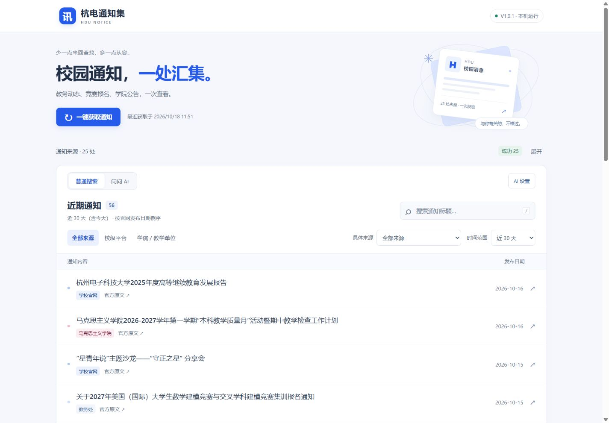
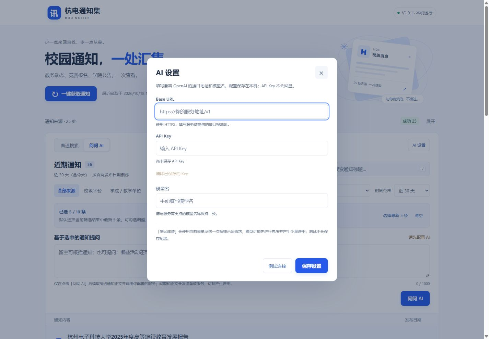

# 杭电通知集 · HDU Notice Hub

把杭州电子科技大学的 **25 个选定公开通知栏目**汇集到本机网页，减少在不同网站之间来回查找的次数。

当前版本：**V1.0.1**。项目由学生开发和维护，**非学校官方平台**；通知要求、正文和附件请以官方原文为准。

[下载 Windows 安装程序](https://github.com/xiangyu-wang08/hdu-notice-hub/releases/download/V1.0.1/hdu-notice-hub-V1.0.1-windows-x64-Setup.exe) · [安装与使用手册](docs/INSTALL.md) · [下载 PDF 手册](https://github.com/xiangyu-wang08/hdu-notice-hub/releases/download/V1.0.1/hdu-notice-hub-V1.0.1-install.pdf) · [全部版本](https://github.com/xiangyu-wang08/hdu-notice-hub/releases)

## 能做什么

- 一次获取 6 个校级平台、19 个学院／教学单位的选定通知栏目。
- 按来源分组、具体来源、时间范围和标题关键词筛选，按官网发布日期排序。
- 查看每个来源的成功、部分成功或失败状态，单独重试失败来源。
- 保存本地缓存，重启或离线时继续查看已获取的标题、日期和原文链接。
- 在浏览器打开官方原文；支持桌面和窄屏布局。
- 可选“问问 AI”：选择通知并提问，按需读取公开网页正文，列出回答、正文来源及读取失败原因。

默认“普通搜索”在本机筛选通知列表，无需 API Key、学校账号或 Codex。使用 AI 时，由你自行配置兼容 OpenAI 的 HTTPS 接口、API Key 和模型名；提问及所选正文会发给该服务，可能产生费用。源码运行只使用 Python 标准库；Windows 免安装包内置所需运行环境。

## 界面预览

桌面布局：



查看 [窄屏布局截图](docs/images/mobile.png)（同一网页的响应式显示）。

首次打开的 AI 设置（三项均为空）：



## 快速开始

### Windows 10 / 11 x64：安装版（推荐）

1. 点击 [下载 Setup.exe](https://github.com/xiangyu-wang08/hdu-notice-hub/releases/download/V1.0.1/hdu-notice-hub-V1.0.1-windows-x64-Setup.exe)，不用下载或解压程序 ZIP。
2. 双击安装程序，按中文安装向导完成安装。默认安装到当前用户目录，不需要安装 Python 或管理员权限。
3. 使用桌面或开始菜单中的 **杭电通知集** 快捷方式启动，浏览器会自动打开本机网页。
4. 点击 **一键获取通知**。首次使用需要联网获取。
5. 使用结束后，在开始菜单选择 **杭电通知集 → 关闭服务**，或关闭启动时的服务窗口。

卸载可使用 Windows“设置 → 应用”或开始菜单的“卸载”入口。升级和卸载会先关闭本程序服务，并保留 `data/` 中的通知缓存与 AI 设置。全新安装的 AI 三项配置均为空；从 V1.0.0 升级会保留缓存，首次使用 AI 时再自行配置。迁移到另一台电脑或另一个 Windows 用户时，需要重新填写 Key。完整步骤见手册。

使用期间保持服务窗口运行，可以最小化。只关闭网页不会停止服务。默认地址为 `http://127.0.0.1:8765/`；端口占用时尝试 `8766` 至 `8775`，以窗口显示地址为准。

如需免安装使用，也提供 [便携 ZIP](https://github.com/xiangyu-wang08/hdu-notice-hub/releases/download/V1.0.1/hdu-notice-hub-V1.0.1-windows-x64.zip)：完整解压并保留 `_internal`，双击 EXE，结束时运行同目录的 `关闭服务.cmd`。

### Python 3.10+：源码版

下载并解压 [源码 ZIP](https://github.com/xiangyu-wang08/hdu-notice-hub/releases/download/V1.0.1/hdu-notice-hub-V1.0.1-source.zip)，在包含 `portable_launcher.py` 的目录打开终端：

```powershell
python --version
python portable_launcher.py
```

源码运行无需 `pip install`。停止服务时，在同一目录另开终端执行：

```powershell
python portable_launcher.py --stop
```

完整的 Python 安装、命令说明、故障排查和升级步骤见 [安装与使用手册](docs/INSTALL.md)。

## 读取范围与状态

每次获取时，**每个来源最多读取 5 页**。这不是全校通知目录，也不是完整历史归档。“近 7／30／90 天”和“全部已获取”只筛选已获取内容；较早但仍有效的通知可能位于五页范围之外，请到官方栏目继续查找。

获取由用户点击触发，不提供后台定时监控或消息推送。网站改版、验证页面、网络或 DNS 故障都可能导致部分来源失败，项目不承诺实时或完整覆盖。

| 显示状态 | 含义 |
| --- | --- |
| 已更新 | 本次读取在最多五页的范围内完成，不代表读完全部历史通知。 |
| 部分获取 | 已读到部分页面，后续页面失败；保留本次结果和此前可用内容。 |
| 获取失败 | 本次未获得可用结果；已有缓存仍可查看。 |
| 缓存 | 数据从本机恢复，不代表最近一次获取成功或内容仍是最新。 |

展开“通知来源”并查看来源详情，可以核对最近尝试、获得数据、完整读取时间、已获取日期范围及错误信息。两次获取至少间隔 30 秒。标题搜索仅匹配标题，不搜索通知正文或附件。

## 普通搜索与问问 AI

默认使用“普通搜索”。切换到“问问 AI”后，默认勾选当前筛选结果中最新的 5 条，最多选择 10 条。可以填写问题（最多 1000 字）；留空时整理主要内容、重要日期及个人需要完成的事项。来源、时间或关键词变化后重新默认选择 5 条，“再显示 20 条”保留勾选。

首次使用点击“AI 设置”，自行填写 **HTTPS Base URL、API Key、模型名**，三项初始均为空。支持兼容 OpenAI 的 `/chat/completions` 接口；Base URL 可填写服务商提供的 `/v1` 等兼容前缀，也可填写完整聊天端点。模型名须与服务商支持的名称一致。

- **保存设置**只保存配置；**测试连接**使用当前表单发出一次短提示词请求，不自动保存。连接测试和正常提问的输出预算均为最多 **1500 tokens（包含模型思考）**，可能收费，均不自动重试。
- Key 使用当前 Windows 用户的 **DPAPI** 加密保存到 `data/ai-settings.json`，不会明文保存、回显或写入日志，也不存入浏览器存储。已有 Key 时密码框留空保存会保留它；输入新 Key 可替换，点击“清除已保存的 Key”可删除本机保存的 Key。跨电脑或跨 Windows 用户无法直接沿用加密 Key，应重新填写。
- 提交任务会将**你的问题和选中通知的公开网页正文**发送给配置的服务。普通获取只读取通知列表；AI 仅按需读取公开 HTML，**不解析附件、不做 OCR**。没有可用正文时不调用模型；部分读取失败会单独列出原因。
- 正文最多 4 路并发读取，单页超时 15 秒；每篇最多 6000 字、整批最多 30000 字，超限保留首尾并标注。模型请求超时 90 秒。空回答因输出预算耗尽或仅返回思考内容时，会给出对应提示。
- 回答以纯文本显示，并附程序核对的正文来源、原文链接和读取情况。任务以提交时的选择为准，后续筛选不改变本次范围；一次只进行一个 AI 操作。结果仅保存在当前服务内存，重启后不保留。

AI 回答供辅助阅读，请核对官方原文中的截止日期、办理要求和附件。AI 设置的 Key 加密保存依赖 Windows；其他系统的源码用户仍可使用普通搜索。

## 25 个选定来源

来源清单及解析类型由 [sources.py](sources.py) 维护。名称是项目中配置的栏目名称，网站当前展示名称可能变化。

| 校级平台（6 个） | 选定官方栏目 |
| --- | --- |
| 教务处 | [通知公告](https://jwc.hdu.edu.cn/13022/list.htm) |
| 学校官网 | [通知公告](https://www.hdu.edu.cn/tzgg/list.htm) |
| 图书馆 | [通知公告](https://tsg.hdu.edu.cn/13807/list.htm) |
| 研究生院 | [通知公告](https://grs.hdu.edu.cn/13270/list.htm) |
| 就业网 | [通知公告](https://job.hdu.edu.cn/news/index/tag/tzgg) |
| 学工部 | [通知公告](https://student.hdu.edu.cn/13775/list.htm) |

| 学院／教学单位（19 个） | 选定官方栏目 |
| --- | --- |
| 通信工程学院 | [通知公告](https://com.hdu.edu.cn/12370/list.htm) |
| 机械工程学院 | [通知公告](https://me.hdu.edu.cn/12685/list.htm) |
| 电子信息学院 | [通知公告](https://ee.hdu.edu.cn/13579/list.htm) |
| 计算机学院（软件学院） | [通知公告](https://computer.hdu.edu.cn/12269/list.htm) |
| 自动化学院（人工智能学院） | [通知公告](https://ac.hdu.edu.cn/12628/list.htm) |
| 网络空间安全学院（浙江保密学院） | [通知公告](https://cybers.hdu.edu.cn/12505/list.htm) |
| 材料与环境工程学院 | [通知公告](https://mat.hdu.edu.cn/12404/list.htm) |
| 理学院 | [通知公告](https://cos.hdu.edu.cn/12358/list.htm) |
| 经济学院 | [通知公告](https://eco.hdu.edu.cn/12427/list.htm) |
| 管理学院 | [通知公告](https://mgmt.hdu.edu.cn/12261/list.htm) |
| 会计学院 | [通知公告](https://acc.hdu.edu.cn/12448/list.htm) |
| 外国语学院 | [通知公告](https://forstu.hdu.edu.cn/12757/list.htm) |
| 数字媒体与文法学院 | [通知公告](https://smwf.hdu.edu.cn/14171/list.htm) |
| 马克思主义学院 | [通知公告](https://marxism.hdu.edu.cn/12541/list.htm) |
| 卓越学院 | [通知公告](https://honor.hdu.edu.cn/12326/list.htm) |
| 国际教育学院 | [通知公告](https://intedu.hdu.edu.cn/12675/list.htm) |
| 继续教育学院（数字技术学院） | [通知公告](https://con.hdu.edu.cn/12572/list.htm) |
| 体育教学部 | [通知公告](https://pe.hdu.edu.cn/12309/list.htm) |
| 圣光机联合学院 | [通知公告](https://itmo.hdu.edu.cn/12472/list.htm) |

## 本地数据与网络

通知缓存位于程序目录的 `data/notices.json`，AI 配置位于 `data/ai-settings.json`。程序启动、读取缓存和普通筛选均在本机完成；点击获取会访问配置的官方栏目，点击原文会由浏览器访问对应网站。主动测试或提交 AI 问题时，程序才调用你配置的服务。首次离线启动没有可显示的通知，之后离线可读已保存的列表，打开原文和使用 AI 仍需要网络。

服务只监听 `127.0.0.1`，不直接向局域网或公网提供访问。窄屏截图展示布局效果，不表示手机可以直接访问电脑上的本机地址。请使用普通的可写文件夹运行程序。正式发布包排除整个 `data/` 以及运行记录和凭据；转交程序时发送干净的发布 ZIP，勿发送自己运行后的目录。

## 开发与构建

```text
server.py                 本机 HTTP 服务、官网列表解析与缓存
sources.py                25 个来源配置
ai_service.py             可选 AI 任务、接口调用与 DPAPI 配置
notice_content.py         按需读取通知公开 HTML 正文
portable_launcher.py      启动、端口回退与关闭控制
web/                      本地网页资源
tests/                    服务与数据处理测试
packaging/                Windows 构建、打包与第三方许可证
docs/INSTALL.md           安装与使用手册
```

运行测试：

```powershell
python -m unittest discover -s tests -v
```

制作 Windows 安装程序与便携包需要额外的构建依赖；普通用户不需要安装它们。在 Windows x64、Python 3.12 环境下，另需安装 [Unicode NSIS 3](https://nsis.sourceforge.io/Download)，并确保 `makensis.exe` 位于 PATH；也可向构建脚本传入 `-Makensis` 完整路径：

```powershell
py -3.12 -m venv .venv-build
.\.venv-build\Scripts\python.exe -m pip install -r packaging\build-requirements.txt
powershell -NoProfile -ExecutionPolicy Bypass -File packaging/build.ps1
```

构建产物输出到 `release/V1.0.1/`，版本由 [VERSION](VERSION) 统一读取。构建依赖固定在 [packaging/build-requirements.txt](packaging/build-requirements.txt)，详细贡献约定见 [CONTRIBUTING.md](CONTRIBUTING.md)。

源码附带已生成的 PDF 手册。修改 `docs/INSTALL.md` 后，先安装独立文档依赖并重建 PDF，再制作发布包：

```powershell
.\.venv-build\Scripts\python.exe -m pip install -r packaging/docs-requirements.txt
.\.venv-build\Scripts\python.exe packaging/build_manual.py
```

源码启动、关闭和离线集成检查可运行 `python packaging/smoke_test.py --source`。构建后运行 `python packaging/test_portable.py` 检查免安装包；加 `--online` 会额外读取全部官网并要求本次访问成功，适合人工发布验收，不用于日常离线测试。

安装程序的实机生命周期检查：`python packaging/test_installer_windows.py`。它会在 QA 目录安装、升级和卸载，检查快捷方式、当前用户注册信息及缓存保留；发现已有真实安装或同名快捷方式时会停止，避免覆盖。

## 许可与致谢

本项目代码与文档按 [MIT License](LICENSE) 开源。早期版本中包含朋友的贡献，已获得用于本项目开源的授权；感谢参与开发、测试和提出建议的朋友。

Python、PyInstaller 及随包组件保留各自许可证，详见 [THIRD_PARTY_NOTICES.md](THIRD_PARTY_NOTICES.md) 与 [packaging/licenses](packaging/licenses)。学校与各单位的名称、网站内容和通知原文不因本项目的 MIT 许可而重新授权。

发现问题请提供版本、系统、来源名称和错误信息，到 [Issues](https://github.com/xiangyu-wang08/hdu-notice-hub/issues) 反馈。
